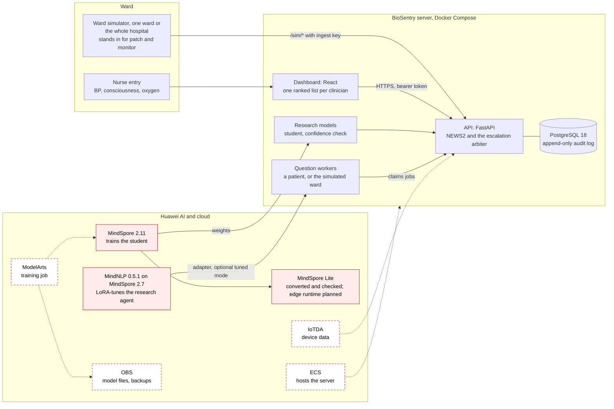
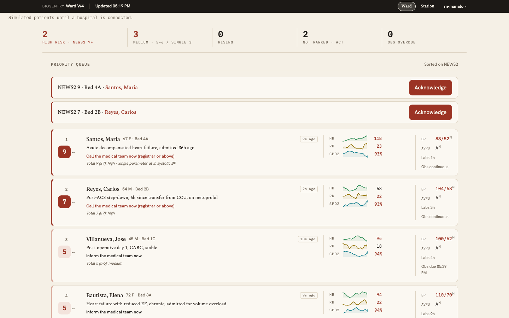
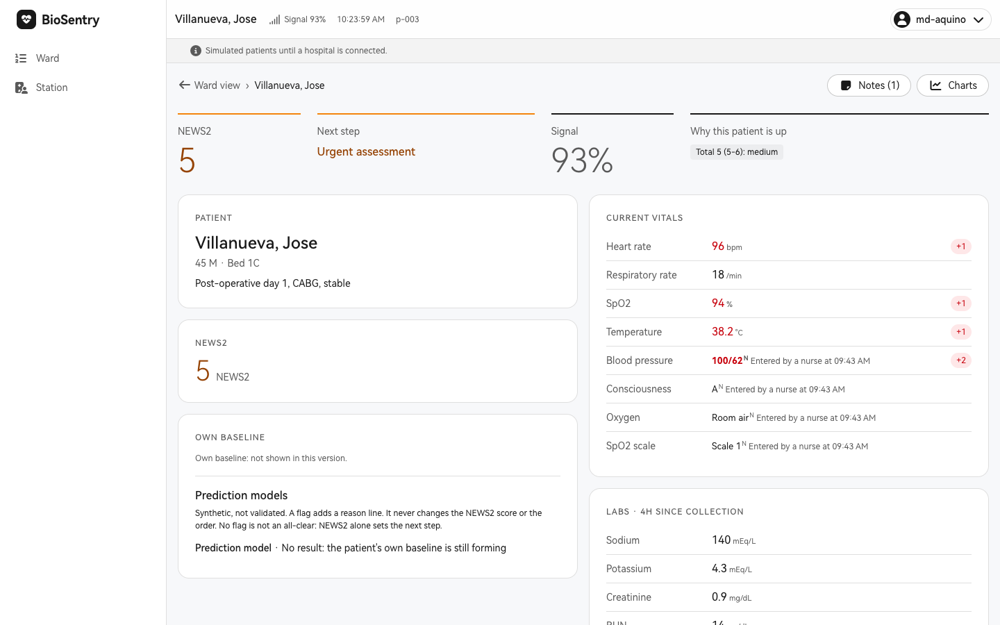
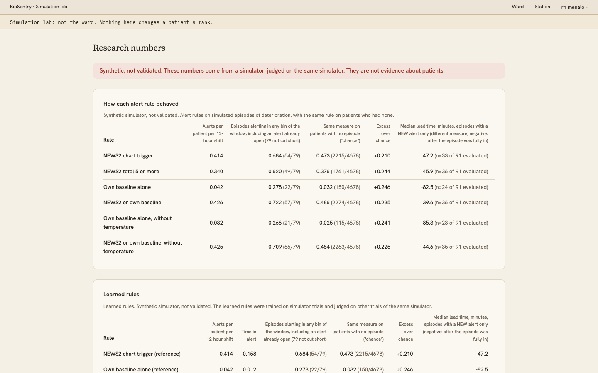
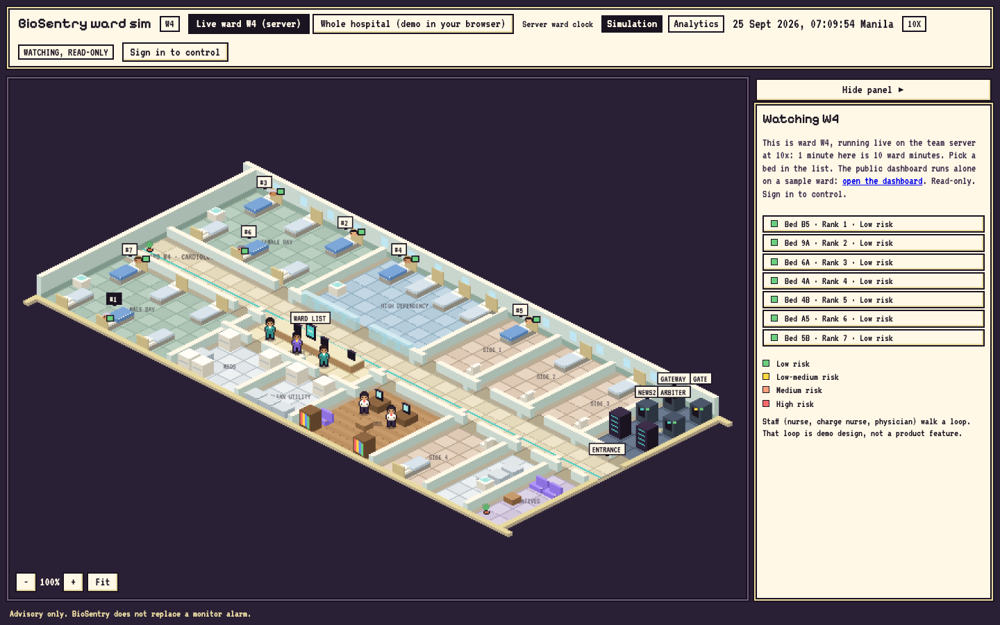

# BioSentry

A ranked early-warning list for hospital wards in the Philippines.

**This is not a diagnosis system.** It ranks and displays. A human decides.

BioSentry answers one question: *of your twenty patients, see this one first.* It takes
vital signs, adds what the hospital already knows (diagnosis, labs, and values a nurse
types in: blood pressure and level of consciousness, and also heart rate, respiratory rate,
SpO2 and temperature when there is no patch or the patch gives no reading) and puts every
patient on one ranked list, one screen per clinician. So a patient can be ranked with no
patch. A typed heart rate, respiratory rate, SpO2 or temperature counts for 12 hours (the
longest gap NEWS2 allows between observation sets; using it for every score is our
judgement), then the patient is NOT RANKED until it is entered again or the patch reads it
again. A patch reading of the same vital, new or still current, replaces a typed value. Blood
pressure, level of consciousness, oxygen and SpO2 scale do not expire. Trend charts show patch
data only.

**Why.** Philippine wards have too few nurses to watch every patient: the DOH standard for government
hospitals is one nurse per 12 beds per shift ([DOH manual](https://www.dbm.gov.ph/wp-content/uploads/Issuances/2013/Joint%20Circular%202013/DOH/Manual%20RSSGH_%203%20levels.pdf)),
and the Philippine General Hospital has reported 1:20
([Acta Medica Philippina](https://actamedicaphilippina.upm.edu.ph/index.php/acta/article/download/3124/2110)).
Automated alerts alone have not shown a clear cut in mortality
([Cochrane review, McGaughey 2021](https://pmc.ncbi.nlm.nih.gov/articles/PMC8608437/)): the gap is unreliable
alerts and too few people to act.
BioSentry's contribution is the process, not the hardware: an offline-first ward system (patch,
gateway and edge server, cloud sync when the network allows) that cuts false alarms and tells
each nurse and physician who to see next.

The list is sorted by **NEWS2**, a published bedside early-warning score (Tier A). A patient
who meets a NEWS2 trigger sits above one who does not. The own-baseline finding (Tier B) is listed as a
reason and breaks ties between equal NEWS2 totals below a trigger; it never moves a patient past a NEWS2
difference. One research model can add a flag to a row as one more reason, labelled synthetic and not
validated: the student with its confidence check. The reward-learned policy is not connected: it showed a loss on
held-out set 2, and the owner dropped its flag (decision models-rl-5). A flag never moves a patient on the list.

**What is here.** The dashboard (`frontend/`) and a slim API (`backend/`: FastAPI over PostgreSQL); the
research models as plain files with their held-out results (`models/`), the code that trains them
(`training/`), the research agent (`research/`) and the team deployment (`deploy/`). The
API serves the committed synthetic ward (`frontend/src/data/synthetic.json`), seeded into the database,
and takes a live ward, or a whole hospital, from the ward simulation (see [The whole hospital](#the-whole-hospital)).

## Results

Two held-out sets of simulated wards. **Held-out set 2 is the large one** (400 trials, 37,062 patients, 1,743 deterioration
episodes). It was read once, with its analysis written before the read, and it is the result to quote. Set 1 is the small
first set (20 trials, 91 episodes).

Set 2, the rules alone:

| Alerting rule | Alerts per patient per 12-hour shift (95% interval) | Deteriorations with a new alert in time | Time in alert |
|---|---|---|---|
| NEWS2 chart trigger | 0.415 (0.411 to 0.420) | 49.0% (854 of 1,743) | 16.6% |
| NEWS2 total of 5 or more | 0.347 (0.343 to 0.351) | 52.9% (922 of 1,743) | 12.6% |
| **Distilled student (MindSpore 2.11)** | **0.425 (0.420 to 0.429)** | **60.1% (1,048 of 1,743)** | **6.5%** |

The student, on its own, alerts about as often as NEWS2, in more deteriorations, and for much less time. That is not the
test that was written before the read. The pre-registered test asks whether a model **added to NEWS2** gains more than the
extra alerts give by chance (gain in excess over chance, trials as the unit, 98.33% interval):

| Added to NEWS2 | Gain over chance | Alerts against NEWS2 | Verdict |
|---|---|---|---|
| student | -0.040 (-0.054 to -0.025) | 1.254 times | **a loss is shown** |
| student with the confidence check | +0.018 (+0.008 to +0.029) | 1.048 times | a gain beyond chance is shown (small) |
| reward-learned policy | -0.013 (-0.0245 to -0.0001) | 1.131 times | **a loss is shown** (at the edge) |

So the student does not add to NEWS2 beyond chance, and the reward policy does not either; only the student with the
confidence check shows a small gain. On the small set 1 (91 episodes) the student alone alerted in 56% of deteriorations
(51 of 91) against 36% for NEWS2 (33 of 91) at the same alerts, and no gain beyond chance was shown for any model added
to NEWS2; that set was too small to tell these apart.

Every row was re-scored with the backend's NEWS2 with 0 mismatches. **These are not clinical results:** the same
simulator makes the data and judges the alerts. The full tables and method are in
[`models/tier_c/student_vitals/held_out_2.txt`](models/tier_c/student_vitals/held_out_2.txt) (set 2) and
[`models/held_out_2/analysis.txt`](models/held_out_2/analysis.txt) (the pre-registered analysis); set 1 is in
[`models/tier_c/student_vitals/held_out.txt`](models/tier_c/student_vitals/held_out.txt). To regenerate any of them, see
[Reproduce the results](#reproduce-the-results).

## Architecture



Red: Huawei technology in use today. MindSpore 2.11 trains the student, and MindSpore Lite converts it
(`models/tier_c/student_vitals/lite.txt`: converted, 20 of 20 test rows match; nothing runs `model.ms` yet).
MindNLP 0.5.1 on MindSpore 2.7 LoRA-tunes the model that the lab question worker can use
(`research/agent_tuning/`, `deploy/compose.tuned.yaml`). Dashed: Huawei Cloud services planned and not running yet. The API runs the student from its exported weights (`models/`), scores NEWS2 on
every read, and stores no score.

## Screenshots

| | |
|---|---|
|  |  |
| The ranked ward list: a charge nurse on the sample ward, sorted on NEWS2, with the reason and next step for each patient. | One patient: each NEWS2 part with its points, the next step, labs, and the research models' flags. |
|  |  |
| The research numbers in the Simulation lab: every alert rule against chance, on held-out simulated wards. | The ward simulator, watching the team server's ward W4 read-only. |

All patients are synthetic.

## Use it now

BioSentry is deployed. You do not need to install anything to see it.

| App | Address | What it is |
|---|---|---|
| Dashboard | <https://biosentry-dashboard.pages.dev> | The clinician's ranked list on a sample ward. Choose a clinician; any passphrase is accepted. |
| Ward simulation | <https://biosentry-ward-sim.pages.dev> | The simulated hospital, and a read-only view of the team server's ward W4 (no names or ids). When the server runs a whole hospital, it draws the building, floor by floor, with a card for each bed in use. No sign-in to watch. |

Both public sites deploy from `main` and show synthetic patients. The dashboard has no server behind it: it runs
alone on a sample ward, and what you enter is gone on reload. Its research pages are open to every demo clinician
(<https://biosentry-dashboard.pages.dev/lab/research>).

The connected version (the simulation writes to one API and the dashboard reads the same ward, live) runs on
the team's server. It is private to the team: a clinician signs in with their own passphrase. Ask the team for
access; [`deploy/README.md`](deploy/README.md) says how it is built and kept.

To run or change the code yourself, see [Run it yourself](#run-it-yourself-developers).

**Your own feed.** The API takes a ward's data through one door: the `/sim/*` routes, with an ingest key
in the `X-Ingest-Key` header. The ward simulation is one sender; any system that posts the same shapes
(a run, then batches of observations) reaches the same scoring, own-baseline tracking and ward list, with
no change to the dashboard. A run may list 1 to 12 units, and a patient may name its unit and the person it is (see
[The whole hospital](#the-whole-hospital)). Today the door accepts only data marked synthetic, and nothing here is
validated for clinical use; a feed of real patients would need that rule changed, and a validation first.

## The whole hospital

The API can hold a whole hospital, not only ward W4. All of this is synthetic.

- **Units.** A run lists 1 to 12 units, each with an id, a name, a floor and a kind. A run that lists none is one unit,
  ward W4. W4 is the home unit. A patient row is one stay in one unit.
- **Kinds.** `ranked` units are scored: NEWS2, the own-baseline finding and the research model flag, and a rank within
  the unit. A `shown` unit gets a NEWS2 band for a patient whose inputs are all there, and no rank and no score. An
  `unranked` unit gets neither. The simulator sends the ER as `shown`, intensive care as `unranked`, and W4, Medicine 3A,
  Medicine 3B and Surgery 5A as `ranked` (owner decisions orch-h1 and sim-lab-6). Today the ER is `shown`: a band and no
  rank. Ranking the ER with NEWS2 as an aid, labelled, is decided (orch-h10) and in progress, not built yet. NEWS2 outside W4 is display only and changes no care
  (orch-h2, sim-lab-7). Giving each floor its own department, and where each department's vitals
  come from, is decided (orch-h7, orch-h8, orch-h9) and being built; this section describes only what the code shows today.
  The floors are 0 (ER), 2 (intensive care), 4 (W4), 5 (Surgery 5A), 3 (Medicine
  3A) and 1 (Medicine 3B).
- **Transfers.** A move between units is the old stay ending as `transferred`, with the unit it went to, and a new stay of
  the same person in the new unit. Stays of one person share a `person` id.
- **Deaths.** A death is a stay ending as `died`. It shows in the unit's stay history and nowhere else: the patient leaves
  every live view (orch-h5).
- **Who sees what.** A clinician sees their own patients only, in any unit. Migration 0014 adds one charge nurse for each
  other unit (`cn-er`, `cn-icu`, `cn-med3a`, `cn-med3b`, `cn-surg5a`), with no passphrase from the migration
  (orch-h3). An answer that holds a whole unit (the live view, the research table, lab runs, sim commands) is for that
  unit's own clinicians. A hospital admin reads every unit.
- **Routes.** `GET /wards` lists the units with how many patients the caller may see. `GET /wards/{unit}/rows`, `.../stays`
  and `.../overview` are per unit. The dashboard still asks for W4 only. The unit pages are read by the ward simulator's
  "Hospital admin" view and by any client of the API.
- **The runner.** The simulator's headless runner (`WARD_MODE`, `WARD_SCENARIO`) writes the hospital. In `hospital` mode it
  sends W4 and its moves, and every other unit's people from the hospital vitals engine, as that unit's patients. A
  dashboard action that names another unit is not applied: the engine takes no orders. The default `WARD_MODE` is `ward`
  (W4 alone), so a server shows a hospital only when it is set to `hospital`.
- **`WARD_SCENARIO`.** The hospital a new run starts. The default is `typical`: the typical hospital at seed 101, with W4's
  12 starting patients drawn from that seed (orch-h4). `pitch` is the same hospital with the 12 hand-written pitch patients.
  `calm`, `surge`, `more-nurses` and `critical` are the other named scenarios. A saved hospital continues as it is.
- **The month loop.** A hospital run lasts one ward month (30 days). Then the run ends and the next seed starts in a new
  run, with the same scenario and the next seed (the seed before it, plus one; `typical` starts at seed 101). The runner saves its state only once the API has accepted the
  new run, and a runner that starts on a month that is over starts the next one at once. The state is in
  `hospital-state.json`. A state file made in one mode is refused by the other.
- **The public list and the bed card.** With `BIOSENTRY_OPEN_WARD_VIEW=true`, three routes need no sign-in:
  `GET /open-view` lists the run's units (id, name, floor, kind), `GET /wards/{unit}/open-view` draws one unit's beds, and
  `GET /wards/{unit}/open-view/beds/{bed}` is one bed's card. A ranked bed's card has its NEWS2 score and band, its trend,
  and the newest heart rate, respiratory rate, SpO2, temperature and blood pressure, each with its time and source.
  A ranked bed's card also has `history`: the last 12 hours of the five vitals (orch-1b).
  Any other bed's card has its state and the reason only. A card holds no name, age, sex, context, note, lab, baseline,
  model flag, clinician or patient id (owner decisions orch-1, orch-h6). All three serve a synthetic run only.
- **Hospital admin (read-only).** Signed in as an admin, the ward simulator page lists every unit, each unit's patients with
  names, NEWS2 and the five vitals, each unit's history, and one patient's page. It reads `GET /wards`, `/wards/{unit}/rows`,
  `/wards/{unit}/stays` and `/patients/{id}`, and writes nothing (orch-h11).
- **ER and intensive care vitals.** A NOT RANKED row of a `shown` or `unranked` unit carries the stored vitals and their
  trends, for a signed-in reader who may see the patient: an admin, or the clinician assigned. It still has no score and
  no rank. The public views never carry them, except a ranked bed's card above.
- **Skip.** A clinician who may control the simulation (a physician or the charge nurse of that unit) can send the
  command `skip` to `POST /wards/{unit}/sim/commands`, with `minutes` of 60, 360, 720 or 1440, to move the whole run ahead
  by 1 hour, 6 hours, 12 hours or 1 day. The API accepts one skip at a time: a second gets 409 until the simulation has
  fetched the first from the command feed. It also gets 409 when the run is not live. No page in this repository sends it
  yet. The simulator's runner applies `skip`.

## Run it yourself (developers)

You do not need this to see BioSentry: the deployed apps are under [Use it now](#use-it-now). This section is
for people who change the code.

You need Node.js `^20.19` or `>=22.12` and make. For the API you also need
[uv](https://docs.astral.sh/uv/) (it fetches Python 3.11 itself) and [Docker](https://docs.docker.com/get-docker/)
(the API's database is PostgreSQL, run from `compose.yaml`). From the repository root:

```bash
make web-install
make web-dev
```

Open the URL Vite prints, choose a department and a clinician, and sign in. With no API (this is the
public demo) there is no server and no real sign-in: any passphrase is accepted, the dashboard serves
the fixture from memory, and whatever you enter is gone on reload.

**With the API**, so that scores are computed by the real NEWS2 and arbiter, and everything you
record is kept:

```bash
make api-install
make db-up                         # PostgreSQL 18 in Docker on 127.0.0.1:5432, waits until healthy
make api-dev                       # http://127.0.0.1:8000, loopback only; creates the schema and seeds on start
cd frontend && VITE_API_URL=http://127.0.0.1:8000 npm run dev
```

Sign in with the dev passphrase `dev-passphrase-local`, for any clinician. **Local development only:**
seeding sets it for every clinician when, and only when, the connection it seeds over is to loopback
(judged after connecting, from the server address libpq actually used, not from the URL; `make db-reset`
asks the same of its connection before it drops anything) and the process is not in production
(`BIOSENTRY_ENV` anything but `local`, which never seeds it, whatever the host). Any other database is
seeded with no passphrases, and a clinician with none
cannot sign in: set one with `make db-passphrase id=rn-manalo` (it prompts twice, or reads one line from
stdin; at least 12 characters; it writes to the database `BIOSENTRY_DATABASE_URL` names). A database
seeded before passphrases existed has none either: `make db-reset` seeds it again.

**Admin (ward overview).** An admin sees, for a unit (the dashboard asks for W4), every bed and its state, who is assigned, each clinician's patient
count, and counts of each clinician's actions in the last 24 hours (by action and outcome; no patient and no
time); the Overview shows no patient name. The admin also reads the ward list and each ranked patient's page, read
only, with every patient on the ward whoever is assigned. The same admin reads every other unit through the unit routes
(see [The whole hospital](#the-whole-hospital)). The admin can read the notes of every patient on the
ward, a NOT RANKED one too (it has no page for anyone). Views are in the audit log (I7) under
the admin's id and every write stays refused. This reverses the earlier rule that the admin saw no patient
name. The role is granted only from a shell with database access, run from
`backend/`: `uv run python -m biosentry.db.admin grant admin-<name>`, then
`uv run python -m biosentry.db.passphrase admin-<name>`. Revoke with
`uv run python -m biosentry.db.admin revoke admin-<name>`. No route can grant or change a role. An admin cannot
write anything and is never assigned to a patient. One admin id per person (for example `admin-santos`), never
shared. Granting and revoking each write an audit row. Clinicians are told in their own menu that an
administrator can see these counts, and every patient's page. Only someone with database access can see who opened the overview: the
admin's own views are in the audit log, and no route shows them to anyone else.

`make db-down` stops the database (the data stays in a Docker volume). The API reaches it through
`BIOSENTRY_DATABASE_URL`, which defaults to the dev database in `compose.yaml` (its password is for
that local container only).

`npm run export:pipeline -- --date YYYY-MM-DD` (in `frontend/`) writes `frontend/src/data/evaluation/pipeline.json` from `src/data/pipeline.ts`; never edit that file by hand. A test fails when the file does not match a fresh export, and the Analytics page of the ward simulator reads it.

`VITE_API_URL` is read when the dashboard is built or started: set, it talks to the API and carries
no dataset; unset, it uses the fixture. The API allows the dashboard on `localhost` and `127.0.0.1`,
ports 5173 and 5174 (the ward sim on 5180 and 5181). The ward sim posts to `/sim/*` with the header
`X-Ingest-Key`, which must equal the API's `BIOSENTRY_INGEST_KEY` (`make api-dev` sets `dev-local`;
with the variable unset the ingest routes answer 503). There is one shared ward: `POST /sim/runs`
carries a `client_id` (one per sim page load), and while the newest run is live (not ended, last batch
or creation within 30 seconds) a different `client_id` gets 409 and nothing is written; the same one may
replace its own run. A batch for a run that is no longer the newest also gets 409.
`POST /patients` refuses a bed that a patient still in the ward already has (compared trimmed, ignoring
case) with 409 and writes nothing; a bed whose patient has left is free again.
`GET /sim/runs/{id}/actions?after={seq}` (same key) tells the sim what clinicians did: one row per
acknowledgement, vitals entry, note (never its text) or admission, at most 200 in `seq` order after the cursor.
`POST /wards/{ward}/sim/commands` (bearer token; an md or the charge nurse of that unit, else 403; `GET /wards/{ward}/live`
says `can_control`) queues one of `set_speed` (with `speed` 0, 1, 10 or 60), `reset`, `skip` (with `minutes` 60, 360, 720 or
1440; the whole run moves ahead; one skip at a time, a second gets 409 until the sim has fetched the first), or
`inject_deterioration`, `start_arrhythmia`, `detach_patch`, `apply_patch` (with the caller's `patient_id`, else 404) for
the sim, and answers 409 when the ward is not receiving data from a live sim run. `GET /sim/runs/{id}/commands?after={seq}`
(same key) hands them to the sim in the same way as the actions.
`GET /patients/{id}/baseline` (bearer token, same visibility, 404 and audit as the patient route, action `view_baseline`)
serves a research finding of how far each of five vitals sits from the patient's own baseline: derived,
synthetic, not validated; it stores nothing. Heart rate, respiratory rate and SpO2 are the vitals the ward uses as a
tie-break and a reason. Temperature is `unavailable` (`no_history`): the patient read keeps no temperature history. The
fifth vital is systolic blood pressure (`systolic_bp`). It is charted, not streamed: its 15-minute bins are the median of
the charted readings (nurse or device) in each set, so it needs no patch, and a ward that charts every few hours has a
baseline that forms slowly, never filled. It is shown only: it feeds no rank and no reason.
A device vital whose live value is not from the patch, or whose patch has not sampled in the last 30 minutes,
is `unavailable` (`patch_not_live`) and flags nothing. The detector runs on its code defaults (k 2.0,
p 3), not the k 4.0, p 8 the research sweep chose in `models/tier_b/baseline/params.json`.
The baseline is the first 24
valid bins (6 hours) from admission when it is known, from the first stored bin when it is not (every patient
present before the run), and from the oldest bin still kept once the 7-day prune or the 672-bin cap has dropped
earlier ones, so a long stay is baselined on mid-stay data; the response says when the latest reading was
taken (`latest_at`), where the baseline starts (`baseline_from`) and whether admission is known.

`VITE_ANALYTICS_URL`, when set to a path on the same site (for example `/simulator/#analytics`), adds an Analytics link to the top bar; any other value hides it.

`make check` runs lint, types and tests for both halves; the API tests need the database, so run
`make db-up` first (each test works in its own copy of a seeded database and drops it). `make db-reset`
drops every table and seeds again. `make contract` regenerates `frontend/src/types/generated.ts` from the Pydantic
schemas. Every target is in the [Makefile](Makefile).

## Reproduce the results

Every number in [Results](#results) comes from simulator trials that are not committed (about 1.8 MB
per 30-day trial; 400 for set 2). Make them with the ward simulator,
[kitchen-station/biosentry-ward-sim](https://github.com/kitchen-station/biosentry-ward-sim), on Node 25, at
the commit each data card names:

| Trials | Sim commit | Seeds | Data card |
|---|---|---|---|
| ward-v2 (set 1 is seeds 11 to 30) | `f7647c5` | 11 to 30 | [`models/data/ward-v2/card.md`](models/data/ward-v2/card.md) |
| ward-v2-ext (trains the student) | `b4b7cdc` | 61 to 160 | [`models/data/ward-v2-ext/card.md`](models/data/ward-v2-ext/card.md) |
| ward-v2-heldout2 (set 2) | `4b86f96` | 1001 to 1400 | [`models/data/ward-v2-heldout2/card.md`](models/data/ward-v2-heldout2/card.md) |

```bash
# in biosentry-ward-sim, once per row of the table
git checkout f7647c5 && npm ci
npx vite build --ssr src/trial.ts --outDir dist/trial --logLevel warn
mkdir -p trials/ward-v2   # the runner needs the parent folder; each seed folder must be new
for N in $(seq 11 30); do
  TRIAL_SIM_COMMIT=f7647c5 node dist/trial/trial.js --scenario scenarios/default.json --seed $N --days 30 --out trials/ward-v2/seed-$(printf %02d $N)
done
```

Then score them from this repository, in Docker, with the research environment (MindSpore 2.11). The set-up
line is the one in `research/README.md`, "Gate (ML-GATE)":

```bash
docker build --target build -t biosentry-api-build .
docker run --rm -v "$PWD":/app -v biosentry-research-venv:/venv -w /app/research -e UV_PROJECT_ENVIRONMENT=/venv -e UV_LINK_MODE=copy -e UV_PYTHON_DOWNLOADS=never biosentry-api-build sh -c "uv sync --locked && ln -sf \$(ls /venv/lib/python3.11/site-packages/scikit_learn.libs/libgomp-*.so.1.0.0 | head -1) /venv/lib/libgomp.so.1"
alias run='docker run --rm -v "$PWD":/app -v <your trials folder>:/data:ro -v biosentry-research-venv:/venv -w /app -e PYTHONPATH=/app/backend/src:/app -e LD_LIBRARY_PATH=/venv/lib biosentry-api-build /venv/bin/python -m'

# set 1: the NEWS2 rules and the student; compare with the committed file
run research.evaluate_student /data/ward-v2/seed-{11..30} /data/ward-v2-ext/seed-{61..160} > held_out.txt
diff held_out.txt models/tier_c/student_vitals/held_out.txt
# set 2: the same with --held-out-set 2, then the declared test (four commands)
run research.evaluate_student /data/ward-v2-heldout2/seed-{1001..1400} /data/ward-v2-ext/seed-{61..160} --held-out-set 2 > held_out_2.txt
diff held_out_2.txt models/tier_c/student_vitals/held_out_2.txt
```

The four set-2 commands, with the confidence check, the reward policy and `research.heldout2 analyse`, are in
[`research/README.md`, "Held-out set 2"](research/README.md#held-out-set-2-declared-before-it-is-read).

- **The output is plain deterministic text, so `diff` must print nothing.** The commands read no clock and no paths.
- **The student is refitted, not loaded.** `evaluate_student` retrains the chosen teacher and student and
  refuses to print a number unless their weights and ONNX match the committed files byte for byte. That match
  is promised only on linux aarch64 (Docker on an Apple-silicon Mac); the code pins MindSpore to one kernel
  thread. On x86-64 the command can refuse.
- **NEWS2 itself** is re-scored on every row with the backend's code; the output's `parity` line must say
  0 mismatches.

## What you will see

- **Sign-in:** pick a department and a clinician profile, then give the passphrase. The API checks it
  (a wrong one, an unknown clinician and one with no passphrase set all get the same refusal; 5 failures
  for a clinician within 15 minutes lock that clinician out for the rest of the 15 minutes) and audits
  every attempt. The token is kept in memory only, so a reload returns to sign-in. The public demo (no
  API) checks nothing and says so. It lands on the ward, marked as simulated patients until a hospital
  is connected. An administrator types their id under "Administration" (API builds only) and lands on the
  Overview. The dashboard shows ward W4. The other units' charge nurses (`cn-er`, `cn-icu`, `cn-med3a`, `cn-med3b`,
  `cn-surg5a`) are added by migration 0014 with no passphrase. On a database that is not loopback, nobody can sign in as one until the owner sets a passphrase (`make db-passphrase id=cn-er`).
- **Ward:** patients in priority order, each with its score and why. A patient the system
  cannot score is listed as NOT RANKED, with the reason and what to record to fix it. With the API it reads again every 5 seconds (every 2 seconds while the ward runs at 60x and the tab is in front; an administrator reads once and on Refresh); the demo reads every 15 seconds. The top bar shows the ward's clock and speed.
- **Patient detail:** the score and what drives it, vitals and labs with where each value
  came from, notes, and trend charts (patch data only). With the API it reads again every 5 seconds (every 2 seconds while the ward runs at 60x and the tab is in front; an administrator reads once and on Refresh); the demo reads every 15 seconds. The top bar shows the ward's clock and speed.
- **Overview:** for an admin only, read only, from the "Administration" entry at sign-in (shown when the
  dashboard talks to the API). Every bed and its state, who is assigned, each clinician's patient
  count, counts of their actions in the last 24 hours, and the simulator status. It reads again on Refresh, never on a timer, because every
  view is recorded in the audit log. An admin lands here, with a "Ward list" link to the ward and
  patient pages (read only: no alerts, no timer, a Refresh button, no write control; the notes load when the
  drawer opens), and has no station.
- **Station:** admit a patient, enter lab results, upload a document (extraction is a
  placeholder), or see patient flow: who came and went, length of stay and 14 days of bed use.
  A physician or the charge nurse switches between Ward and Station in the top bar.
- **Simulation lab:** the lab, Pipeline and Research pages are reachable by their address only (`/lab`, `/lab/pipeline`, `/lab/research`) and are not in the menu. Research numbers, the pipeline and the research
  agent's findings, under a label that it is not the ward. The one-address deployment also links the ward
  simulator from the lab page.
  A physician or the charge nurse can ask for a simulated run: the simulator's compare runs two arms from one seed that differ in one change (partly paired in hospital mode), apart from the ward that is running. A lab worker beside the ward runner runs it; the
  API only stores the request and the result. Results are synthetic and not validated, and nothing in them changes a
  rank. Each clinician has one at a time and 10 in 24 hours; the ward has 5 waiting at most. The `lab` service of
  deploy/compose.yaml runs them; while it is not running, a request fails after an hour. The list reads again every 5 seconds while a run is queued or running, and stops when none is.

## What the database stores

A PostgreSQL database (the `biosentry` database of the `compose.yaml` container, or whatever
`BIOSENTRY_DATABASE_URL` names). The schema is the numbered SQL files in `backend/src/biosentry/db/migrations/`;
the API applies any not yet applied on start (`make db-migrate` does it without starting the API), and
`schema_migration` records which ran. To change the schema, add the next file
(`0002_what_it_does.sql`); never edit one that is merged. Everything is scoped to a **run**, and the newest run is the
active one: the seeded fixture ward, or a simulated ward posted to `/sim/*`.

- **Stored:** runs, clinicians and who cares for which patient, patients, every observation with its
  source, tier, time and quality (a value, or the reason there is none), 15-minute vital bins (a gap
  is NULL), notes (soft-deleted), acknowledgements, sessions (the token hashed, 12 hours), the
  audit log (ids and outcomes only, sign-in attempts included, never a passphrase; the database refuses UPDATE, DELETE, TRUNCATE and a repeated sequence number, but not a user who can drop its triggers or the table), and the
  sim's event feed, and lab runs (`lab_run`): a clinician's request for a simulated run and its result. A patient row is one stay: its unit, `admitted_at` (NULL when the arrival is not known), `left_at`, `outcome`
  (`discharged`, `higher_care`, `transferred` with the unit it went to, or `died`) and the `person` it belongs to. A run
  has 1 to 12 units (`run_unit`: id, name, floor, kind). Someone who has left drops out of every live view and stays in the
  history. A death shows only there.
- **Pruned:** when a sim batch moves its run into a new sim hour, that run's vital bins older than
  `BIOSENTRY_RETENTION_DAYS` days of sim time (7 when unset) are deleted, and so are its observations
  that old which a newer one of the same patient and code has replaced. The newest observation of each
  patient and code is always kept, so a value that has not changed is still served.
- **Never stored:** scores, ranks, reasons and the NOT RANKED text. They are computed on every read
  (an acknowledgement keeps the score the clinician acknowledged, as they saw it).

## Status

**Built**:

- The dashboard: ward list, patient detail and station views, on a fixture provider or the API.
- The API: sign-in to a session token, server-side clinician scope, audit on every view (a repeat once a minute, I7), NEWS2 and the
  escalation arbiter computed on read, notes, labs, admission, nurse-recorded vitals,
  acknowledgements, and ingest from the ward simulation.
- The research models (synthetic, not validated): a distilled vitals student trained in MindSpore 2.11 and
  converted to MindSpore Lite, a split-conformal confidence check on it, and a reward-driven alerting policy.
  The API loads the student and its check, and a flag adds a reason to a row; the policy is not connected (decision models-rl-5), it stays a research result. A flag never moves a patient.
- The whole hospital on the server: units, floors, kinds, transfers and deaths in the history, the public unit list and
  bed card, the read-only hospital admin routes, ER and intensive care vitals for signed-in readers, and the `skip`
  command (see [The whole hospital](#the-whole-hospital)). Own baseline: heart rate, respiratory rate and SpO2 give the
  reason and the tie-break; systolic blood pressure is a fifth, shown-only vital of the baseline route.
- The baseline comparison: alerts per patient per shift and deteriorations caught, against NEWS2, on
  held-out simulated wards ([Results](#results)).

**Pending:** an identity provider in place of per-clinician passphrases (a clinician locked out by five
bad attempts stays locked for 15 minutes, whoever made them), cloud sync, a hash-chained audit log, Tier B beyond the
own-baseline tie-break, a
signal-quality model, conformal abstention, the models on ward edge hardware, anything measured on real
patients, a sensor pipeline (IoT Device Access), document extraction, and a plain-language
explanation of each ranked alert for the nurse or physician.

**Next:** run the server on Huawei Cloud ECS, train on ModelArts with the data and outputs in OBS, and take
device data through IoT Device Access. Not doing: federated learning, digital twins, reinforcement-learning
assignment, ECG foundation models.

This repository makes no claim about clinical performance. The scores are a published rule
applied to made-up patients.

## Rules the system keeps

- **I1** Missing is missing: nothing is imputed or defaulted to zero.
- **I2** Every value carries where it came from: source, tier, time, quality.
- **I3** Tiers stay separate: Tier A sorts.
- **I4** Abstention is an output: NOT RANKED is a row with a reason and an instruction.
- **I5** No training on BioSentry patients: local data calibrates and validates only.
- **I6** The synthetic flag propagates: every fixture record says `synthetic: true`.
- **I7** Privacy (the technical safeguards of RA 10173; see [Privacy](#privacy)): one screen per clinician, their patients only, audit on every view. A repeated read of the same page by the same clinician is recorded at most once a minute; the first read, every write, and every refusal or not-found answer to a signed-in clinician are always recorded (the owner's decision for the automatic refresh).
- **I8** Transport: BLE to a gateway, then Wi-Fi or 4G to the cloud. NB-IoT is excluded.

## Design rules

- **Fuse inputs, never outputs.** A model may read raw and derived features; it never reads
  another tier's verdict.
- **Escalation arbiter**, the only component that changes displayed priority:
  1. Tier A threshold met: escalate unconditionally.
  2. Tier B significant finding: list it with the pathway; it breaks ties between equal NEWS2
     totals below a trigger.
  3. Notes-layer concern: raise and attach the trigger phrase (v2).
  4. Missing required input: NOT RANKED, naming what is missing.

  The fixture data follows rules 1 and 4. Rule 2 runs only on stored history: no fixture or seeded
  patient has a significant own-baseline change, so none shows a flag. Only a `ranked` unit is scored by the arbiter; a
  `shown` unit gets a NEWS2 band and an `unranked` unit gets nothing.
- **Ward view** must be filtered server-side to the signed-in clinician's patients, on every
  call. The API does this from its care assignments; the fixture provider stands in when there is no API.
- **Look:** follows the studio brand book (foundation v1), kept quiet for a clinical surface.
  Paper ground, Flour cards, Linen hairlines, Char ink; Slate only for chart lines, never text;
  Scorch marks what needs action (NEWS2 7+ solid, 5-6 or a single 3 as an edge), sage marks
  stable. Fraunces for names, Spectral for text, IBM Plex Mono for numbers and labels, Hanken
  Grotesk for buttons. No dots, shadows or gradients. Tokens are in `frontend/src/index.css`.
- **Role-aware:** each row shows the NEWS2 response for the signed-in role (RCP 2017, Chart 4):
  a nurse sees whom to call, a physician sees what assessment is due.

## Before you expose it anywhere

- **Synthetic data only.** No real patient data exists in this repository. Every run is a `fixture`
  or `synthetic` run and the database refuses a run whose `synthetic` flag is false; the flag stays on
  every run and row (I6) because a later dataset will need it.
- **Sign-in is a passphrase per clinician** (scrypt, rate-limited, audited), not an identity provider,
  and the dev passphrase exists only for a database on loopback. The public demo has no sign-in at all.
- **Keep the API off the internet.** Run it on loopback, or deploy it on the team VPS as described in
  [deploy/README.md](deploy/README.md): the API is published on the host's loopback only, the database
  not at all, and teammates reach it over Tailscale. In production (`BIOSENTRY_ENV=production`) the
  process refuses to start on the dev database password (in the URL text, and, at every connection, in the
  password libpq actually used: PGPASSWORD and a passfile count) or an ingest key that, once stripped, is
  under 32 characters or has fewer than 8 distinct ones.
  `BIOSENTRY_CORS_ORIGINS` (comma-separated) overrides the origins the dashboard may be served from; the
  local ones stay the default.
  `BIOSENTRY_OPEN_WARD_VIEW=true` (owner decision S-3; off when unset or `false`, any other word stops the
  start) adds three routes (see [The whole hospital](#the-whole-hospital)). `GET /wards/{ward}/open-view` shows anyone who
  can reach the API the ward simulator's drawing of one unit with no sign-in: bed, rank and NEWS2 band, and staff figures,
  no names or ids. `GET /open-view` lists the units. `GET /wards/{ward}/open-view/beds/{bed}` is one bed's card. They serve
  a synthetic run only, still need a sign-in for control, and their views leave at most one audit row a
  minute for each route and unit. The setting is allowed in production and logs a warning at start. On a public address (`deploy/compose.public.yaml`) the
  team's value is not read; the separate `BIOSENTRY_PUBLIC_OPEN_WARD_VIEW=true` opts in (`deploy/README.md`, "The
  public ward page", owner decision 2026-11-14).

## Privacy

No real patient's data is in this repository or on the team server. The database refuses a run whose
`synthetic` flag is false (I6), and the one real dataset, the open, de-identified eICU-CRD demo, is used
offline for aggregate numbers only (`models/data/eicu-crd-demo/card.md`).

**What the code enforces now:** the technical safeguards that the Data Privacy Act of 2012 (RA 10173) asks for.

- **Need to know.** A clinician's list holds their assigned patients only. A patient they may not see answers
  the same 404 as one that does not exist.
- **Accountability.** Every view, write and refusal leaves an audit row, and audit rows cannot be deleted (I7).
- **Least data to the agents.** A question about a patient freezes an allow-listed copy of that patient's data,
  with no name, bed, id, free text, note or lab (`backend/src/biosentry/schemas/lab.py`). The worker that
  answers it has no route to the internet, calls no outside model, and writes nothing.
- **Sessions.** The dashboard keeps the token in memory only, and the server stores only its sha256.
- **The public ward view** shows bed, rank and NEWS2 band, never a name or id, and only for a synthetic run. A ranked bed's
  public card also shows its newest five vitals with time and source, still with no name or id.
- **Retention.** A run's vital bins older than `BIOSENTRY_RETENTION_DAYS` (7 when unset) are deleted.

**What a hospital would add before the first real patient.** None of this is built; most of it is organisation, not code.

- A Data Protection Officer, a privacy impact assessment, and registration with the National Privacy Commission.
- A lawful basis and a notice for processing health data, which is sensitive personal information, and a
  way for patients to see and correct what is held about them.
- Breach notification to the Commission within 72 hours.
- **Data kept in the Philippines.** The server and its backups would run on Huawei Cloud ECS and OBS in the
  AP-Manila region, with OBS server-side encryption for the backups. Today `deploy/backup.sh` writes
  unencrypted dumps beside the database. Training stays on synthetic data (I5), so no patient record has to
  leave the country to train on ModelArts.
- An identity provider in place of per-clinician passphrases. Sign-out would also end the session on the
  server; today a token lasts until it expires, up to 12 hours.

## Licence

The code is MIT licensed ([LICENSE](LICENSE)). Datasets keep their own licences and none is committed here
(`training/REGISTRY.md`).

Competition entry for the Huawei ICT Competition Innovation Track. No real patient data exists in this repository.
